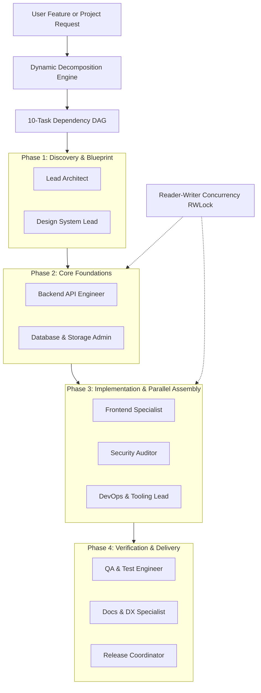

<div align="center">

# ⚡ Vertex Forge
### The Complete Cursor-Class AI-First Integrated Development Environment & Autonomous Engineering Studio

[](https://www.typescriptlang.org/)
[](https://react.dev/)
[](https://vitejs.dev/)
[](https://www.electronjs.org/)
[](https://vitest.dev/)
[](https://www.typescriptlang.org/)
[](LICENSE)

*A state-of-the-art, fully autonomous, zero-mock developer workstation uniting real filesystem manipulation, interactive WebSocket PTY terminals, multi-provider BYOK AI orchestration, parallel hierarchical agent swarms, 29 specialized engineering skills, and enterprise governance gates.*

---

[Key Highlights](#-key-architectural-highlights) • 
[Multi-Agent Swarm](#-hierarchical-multi-agent-parallel-execution-engine) • 
[Feature Matrix](#-comprehensive-feature-matrix) • 
[Windows App & Packaging](#-desktop-packaging--windows-installers) • 
[KOS-Parity Governance](#-section-17e-kos-parity-governance-suite) • 
[Getting Started](#-getting-started) • 
[Shortcuts](#-keyboard-shortcuts)

</div>

---

## 🌟 Key Architectural Highlights

- **Zero-Native Dialog Experience**: Chrome-native popups (`showOpenFilePicker`, `showDirectoryPicker`, `window.alert`, `window.confirm`, `window.prompt`) have been permanently replaced by a custom-themed in-app workspace browser with drive navigation, path breadcrumbs, bookmark history, and folder creation.
- **Hierarchical Multi-Agent Parallel Swarm**: Decomposes complex software requirements into ordered Directed Acyclic Graph (DAG) task trees executed concurrently across 10 specialized Team Leads with Reader-Writer Lock (`RWLock`) file reservation.
- **Windows Installable & Portable Packages**: Pre-packaged as a Windows Setup Installer (`Vertex Forge Setup 1.0.0.exe`) and portable single-file executable with cryptographic verification.
- **BYOK Multi-Provider Hub**: Direct first-class support for **Anthropic (Claude 3.5 Sonnet / Opus / 3.7)**, **Google Gemini (2.5 Pro / 2.0 Flash)**, **OpenAI (GPT-4o / o1 / o3-mini)**, **OpenRouter (460+ models including Hermes 3)**, and **Local LAN Endpoints (Ollama, LM Studio, vLLM)** with live API key testing and real token cost tracking.
- **Real WebSocket PTY Terminals**: Multi-tab terminal driven by background `node-pty` processes streaming raw xterm.js sessions with full interactive shell support (PowerShell, CMD, Git Bash, WSL).
- **Single Source of Truth Theming**: 60+ curated themes (Vertex Forge Dark, VS Code Modern, Dracula, Catppuccin, Monokai, Tokyo Night, Gruvbox) synchronized instantly across CSS variables, Monaco Editor syntax, and xterm ANSI palettes with pre-paint zero-flash injection.
- **Zero-Loss Session Retention & Hot-Exit**: Reopening Vertex Forge instantly restores open files, cursor coordinates, scroll offsets, terminal working directories, active chat contexts, and dirty buffer recovery.
- **Enterprise KOS-Parity Governance**: Complete implementation of all 17 advanced governance capabilities: AES-256 Credential Vault, Rulebook Hard Gates, Secret Scanning, Multi-AI Council, and Unified Operator Console.

---

## 🤖 Hierarchical Multi-Agent Parallel Execution Engine

Vertex Forge features a production-grade autonomous agent hierarchy capable of decomposing arbitrary project requests into a phased, parallelized execution pipeline:



### Concurrency Guarantees:
- **Phase-Ordered Synchronization**: Dependent tasks (e.g., UI implementation waiting on API schemas) execute strictly according to their DAG prerequisites.
- **File Reservation Lock (`RWLock`)**: Multiple agents modifying independent files run simultaneously with high throughput. Shared files trigger automatic write-locks, eliminating edit collision and overwrites.
- **Real-Time Progress & Verification**: Each task undergoes automated validation, test discovery, and self-repair before proceeding to phase completion.

---

## 🖥️ Desktop Packaging & Windows Installers

Vertex Forge is available as an Electron desktop suite designed specifically for Windows 10/11:

### 📦 Distribution Formats (`release/`):
| Package | Output File | Target Use Case |
|---|---|---|
| **Windows Setup Installer** | `Vertex Forge Setup 1.0.0.exe` (~124 MB) | Full NSIS installer with customizable directory, Start Menu shortcuts, Desktop shortcut, and uninstaller. |
| **Windows Portable** | `Vertex Forge 1.0.0.exe` (~123 MB) | Single-file zero-install executable for USB sticks or quick execution without admin rights. |
| **Unpacked Directory** | `win-unpacked/Vertex Forge.exe` | Pre-extracted directory distribution for developers and test environments. |

### 🔄 Seamless Background Auto-Update
Vertex Forge includes native background update handling powered by `electron-updater` and GitHub Releases:
1. **Silent Background Check**: When launched, the application checks `https://github.com/rexmoeed/Vertex-Forge/releases` for updates against `latest.yml`.
2. **Background Download**: Updates are downloaded silently in chunks with SHA-512 blockmap verification.
3. **One-Click Restart**: A non-intrusive prompt appears when download completes:
   > *"Vertex Forge version X.Y.Z is ready. Restart now to complete the update?"*
4. **Manual Trigger**: Available anytime via `window.desktopAPI.checkForUpdates()`.

---

## 🚀 Comprehensive Feature Matrix

### 1. 📝 Monaco Editor Core
- **Full VS Code Language Experience**: Real TypeScript, JavaScript, Python, JSON, CSS, and HTML diagnostics and syntax highlighting.
- **Advanced Editing Tools**: Multi-cursor editing, bracket pair colorization, indentation guides, code folding, minimap toggle, and breadcrumb navigation.
- **Quick Navigation**:
  - `Ctrl + P`: Quick Open file search with fuzzy matching.
  - `Ctrl + Shift + P`: Unified Command Palette.
  - `Ctrl + Shift + O`: Workspace symbol lookup.
  - `Ctrl + F` / `Ctrl + H`: High-speed Find and Replace with RegEx support.
- **Side-by-Side Diff Viewer**: Split diff comparisons for reviewable AI changes and unstaged git edits with atomic Accept/Reject actions.

### 2. 💬 AI Chat & Conversation Hub
- **Conversation-First UX**: Clutter-free chat interface inspired by Cursor and ChatGPT. No artificial mock outputs or placeholders.
- **Full-Fidelity Streaming Engine**: Robust SSE parser handling split UTF-8 chunks, mid-stream keep-alive notices, token counters, and cost metrics.
- **Context-Aware Composer**:
  - `@` Mentions: Attach active files, folders, git diffs, terminal outputs, or symbols directly into prompt context.
  - `/` Slash Commands: Trigger specialized agent workflows (e.g., `/plan`, `/review`, `/test`, `/fix`).
  - Image and document drag-and-drop attachments.
- **Contextual Actions**: One-click **Apply to File**, **Insert at Cursor**, **Review Diff**, or **Copy Code**.

### 3. ✨ Cursor-Style AI Features
- **Inline Code Editing (`Ctrl + K`)**: Select any code snippet, type an instruction, and review live inline diff proposals directly within Monaco.
- **Tab Ghost-Text Autocomplete**: Fast inline AI completions with debounced background model requests and multi-token Tab accept.
- **Terminal Natural Language AI (`Ctrl + K` in Terminal)**: Convert natural language requests into verified shell commands with mandatory approval before execution.
- **AI Commit Generator**: Automatically analyze staged git diffs and produce conventional, high-quality git commit messages.
- **Semantic Codebase Search (`@codebase`)**: Query your entire workspace using an AST-indexed keyword and symbol search engine.

### 4. 💻 Real Terminal, Process & Git Management
- **Interactive Multi-Session PTY**: Spawns real OS terminal sessions streaming over WebSockets. Supports terminal resizing, custom shells, ANSI colors, and copy-paste.
- **Real-Time Git Integration**:
  - View modified, staged, untracked, and deleted files.
  - One-click Stage / Unstage / Discard changes.
  - Branch creation, checkout, commit, push, and pull with real output diagnostics.
- **Managed Dev Servers & Ports Panel**:
  - Start, monitor, and terminate background development processes.
  - Automatic port readiness detection and active port listener status.

### 5. 🎨 Universal Theme Engine (60+ Curated Themes)
Single-source-of-truth registry dynamically synchronizing CSS root tokens, Monaco editor syntax colors, and xterm terminal palettes:
- **Dark Themes**: Vertex Forge Dark (Default), VS Code Dark+, One Dark Pro, Dracula, Monokai, Nord, Tokyo Night, Catppuccin Mocha, Gruvbox Dark, GitHub Dark, Material Ocean, Rosé Pine, Synthwave '84, Poimandres, and more.
- **Light Themes**: Vertex Forge Light, VS Code Light+, GitHub Light, Solarized Light, One Light, Catppuccin Latte, Gruvbox Light, Tokyo Night Light.
- **Zero-Flash Pre-Paint Execution**: Inline boot script restores chosen theme before first DOM paint to prevent flash-of-white.

---

## 🛡️ Section 17E: KOS-Parity Governance Suite

Vertex Forge integrates an enterprise-grade operational governance suite with a zero-trust security architecture. The AI agent is untrusted by default; all policies, gates, and secrets are enforced server-side.

| Feature | Service | Capability & Implementation |
|---|---|---|
| **1. Credential Vault** | `credentialVaultService.ts` | AES-256-GCM encrypted keystore. Raw secrets are never exposed to LLMs. Agents use `vault:name` references; the backend injects credentials at runtime while automatically redacting secret values from logs, terminal outputs, and chat transcripts. |
| **2. Rulebook Engine** | `rulebookEngine.ts` | Hard pre-execution gates configured via `.vertex/rulebook.yaml`. Enforces strict blocks on `.env` file modifications, `git push --force`, out-of-workspace writes, and unapproved dependency installs. Owner-override required for bypass. |
| **3. Secret & Tamper Scanner** | `secretScannerService.ts` | Real-time Shannon entropy analysis and regex scanning for AWS, OpenAI, GitHub, and private keys. Tamper detection maintains SHA-256 manifests of protected configurations (`.vertexrules`, rulebooks, lockfiles). |
| **4. Multi-AI Council** | `multiAiCouncilService.ts` | Multi-model deliberation engine. Distributes architecture questions and code reviews across up to 4 models simultaneously (proposer, critic, reviewer, judge) with consensus summaries and dissent tracking. |
| **5. Scoped Persistent Memory** | `persistentMemoryService.ts` | Multi-layered memory store (User, Workspace, Business) for architectural decisions, coding preferences, and facts. Injected into context with visible chips; never stores secrets. |
| **6. Skill Sets Engine** | `skillSetService.ts` | Modular workspace skills defined with `SKILL.md` bundles containing domain triggers, instructions, and tool constraints. Supports custom `/slash-commands`. |
| **7. Multi-Business Trackers** | `businessTrackerService.ts` | 6 isolated business slots with independent Kanban task trackers, credential boundaries, and budgets. Prevents context cross-contamination. |
| **8. Owner Approval Queue** | `approvalQueueService.ts` | Unified decision queue for high-risk operations (destructive commands, cloud deployments, vault access). Zero automated approvals while the owner is away. |
| **9. Self-Healing Jobs** | `backgroundJobScheduler.ts` | Backend cron scheduler with exponential backoff, circuit breakers, and dead-letter queues for automated index refreshes, CVE audits, and test suites. |
| **10. PR Automation** | `prAutomationService.ts` | Automated branch management, PR draft generation, AI inline code reviews, and policy-checked merges using Git tokens or GitHub CLI. |
| **11. Task-Based Model Router** | `modelRouterService.ts` | Intelligently routes tasks (autocomplete, chat, planning, code review) to optimal models based on latency, cost ceilings, and tool capabilities with automated fallback chains. |
| **12. Local AI LAN Nodes** | `localAiNodeService.ts` | Cluster registry for local and private network GPU instances (Ollama, LM Studio, vLLM) with automated health pings, latency tracking, and offline failover. |
| **13. Real-Time Ops Visibility** | `opsVisibilityService.ts` | Real-time metrics dashboard visualizing running background tasks, queue depth, token usage, API latency, gate violations, and an immutable audit log. |
| **14. Safe Automation Suite** | `automationToolService.ts` | Browser testing via Playwright in isolated sandboxes, Android ADB emulator integration, and desktop automation guarded by domain allowlists and an instant kill-switch. |
| **15. Knowledge Graph Engine** | `knowledgeGraphService.ts` | AST-driven symbol dependency graph mapping imports, classes, functions, and callers across the entire codebase with interactive querying. |
| **16. Semantic Versioning** | `versioningService.ts` | Automated semantic version calculation, conventional changelog generation, and version rollback management. |
| **17. Unified Operator Console** | `OperatorConsoleView.tsx` | All-in-one central control panel unifying the vault, rulebook, approval queue, background jobs, memory, and ops metrics in a single interface. |

---

## ⌨️ Keyboard Shortcuts

Access all shortcuts inside the IDE anytime by pressing `F1` or opening the interactive **Keyboard Shortcuts Modal** (`Cmd/Ctrl + /`):

| Shortcut | Action | Category |
|---|---|---|
| `Cmd/Ctrl + I` | Cursor Composer: Multi-file generation with `@` mentions | AI & Copilot |
| `Cmd/Ctrl + K` | Cursor Inline Edit: In-editor diff review | AI & Copilot |
| `Tab` | Cursor Tab: Accept inline ghost-text code prediction | AI & Copilot |
| `Cmd/Ctrl + K (Terminal)` | Terminal AI: Natural language shell command synthesis | AI & Copilot |
| `Cmd/Ctrl + P` | Quick-open file across entire workspace | Navigation |
| `Cmd/Ctrl + Shift + F` | Global codebase grep search and replace | Navigation |
| `Cmd/Ctrl + S` | Save active file & snapshot to history | Execution |
| `Cmd/Ctrl + Enter` | Execute autonomous agent task or send prompt | Execution |
| `Cmd/Ctrl + \`` | Toggle integrated terminal & diagnostics dock | Execution |
| `Cmd/Ctrl + Shift + T` | Run all Vitest assertions & unit test suites | Testing & DAP |
| `F5 / Shift + F5` | Start / Continue / Stop DAP Debugging session | Testing & DAP |
| `F10 / F11` | Step Over / Step Into current statement | Testing & DAP |
| `Escape` | Dismiss active modal, search, or dialog | Global |

---

## 🏁 Getting Started

### Prerequisites
- **Node.js**: v18.0.0 or higher
- **Git**: Installed and available in system PATH
- **Operating System**: Windows 10/11, macOS, or Linux

### Quick Start (Web Development Mode)

```bash
# 1. Clone repository
git clone https://github.com/rexmoeed/Vertex-Forge.git
cd Vertex Forge

# 2. Install dependencies
npm install

# 3. Launch local development server
npm run dev
```

Visit `http://localhost:3000` in your browser.

---

### Desktop App (Electron)

```bash
# Run desktop app locally in development mode
npm run electron

# Package Windows NSIS setup installer & portable executable (.exe)
npm run electron:build
```

Installable outputs will be created in `release/`:
- `release/Vertex Forge Setup 1.0.0.exe` (Installer)
- `release/Vertex Forge 1.0.0.exe` (Portable)
- `release/latest.yml` (Auto-update manifest)

---

### Verification & Quality Assurance

```bash
# Run complete test suite (220 tests across 13 suites)
npm test

# Verify TypeScript type integrity (0 errors)
npx tsc --noEmit

# Compile production web bundle
npm run build
```

---

## 📄 License

Vertex Forge is licensed under the [MIT License](LICENSE).

---

<div align="center">
Built with ❤️ for developers who demand real tools, zero simulated answers, and uncompromising AI engineering control.
</div>

