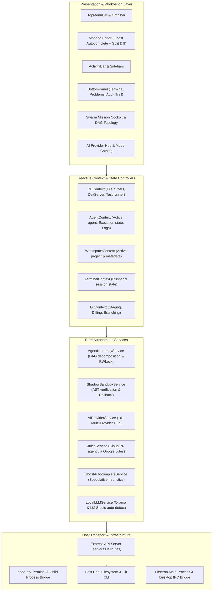
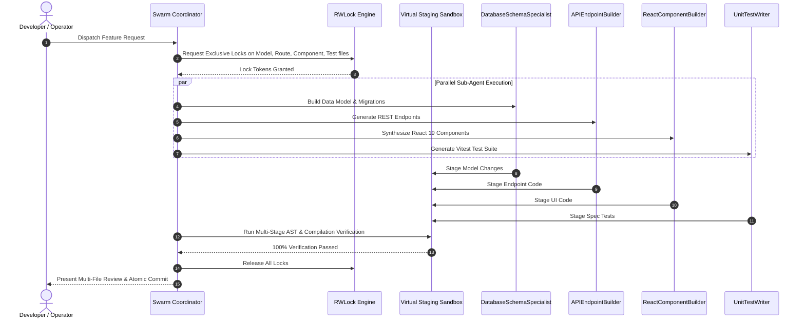

# Vertex Forge Architecture & Systems Blueprint

## 1. Architectural Philosophy

Vertex Forge is built around five core design tenets:
1. **Autonomous, Not Chat-Centric**: Shift from passive inline code generation to multi-agent swarms capable of end-to-end task decomposition, test authoring, and self-healing.
2. **Deterministic Mutation Isolation**: Autonomous code changes never touch the production workspace directly. They stage through an in-memory Virtual File System (VFS) with Abstract Syntax Tree (AST) compilation gates before atomic commit.
3. **Concurrency Without Conflicts**: Multi-agent swarms operate with Reader-Writer Lock (`RWLock`) file reservation, eliminating concurrent write collisions.
4. **Offline First & Privacy Respecting**: Zero external cloud dependency required when running local models (Ollama / LM Studio) in strict privacy mode.
5. **Anti-Monolith Modularity**: Strict codebase enforcement ensuring zero files exceed 500 lines of code repository-wide.

---

## 2. High-Level System Architecture

---

## 3. Autonomous Swarm Topology & Concurrency

When a feature is dispatched via `/swarm-feature`, the `AgentHierarchyService` coordinates 4 parallel specialist tiers:

---

## 4. Multi-Provider BYOK Gateway

The AI Gateway provides a unified interface across 16+ distinct model providers:

- **Google Cloud**: Google Jules (`jules.googleapis.com`) and Google Gemini (`@google/genai`).
- **Commercial Cloud**: OpenAI, Anthropic Claude, DeepSeek, Mistral, xAI, Groq, Cohere.
- **Aggregators**: OpenRouter, Together AI, Fireworks.
- **Local & Air-Gapped**: Ollama (`localhost:11434`), LM Studio (`localhost:1234`), and custom vLLM servers.

Each agent role (Architect, Developer, Reviewer, QA) can be bound to different providers independently with fallback circuits.

---

## 5. Security & Boundary Architecture

1. **Shadow Sandbox Verification**: No code modified by AI touches the disk until AST verification passes.
2. **Credential Vault**: Local AES encrypted storage for all API tokens.
3. **Path Traversal Guards**: Absolute root normalization prevents `../..` directory traversal attacks.
4. **Command Interceptors**: Shell commands that perform destructive operations (`rm -rf`, force push) require operator approval.

